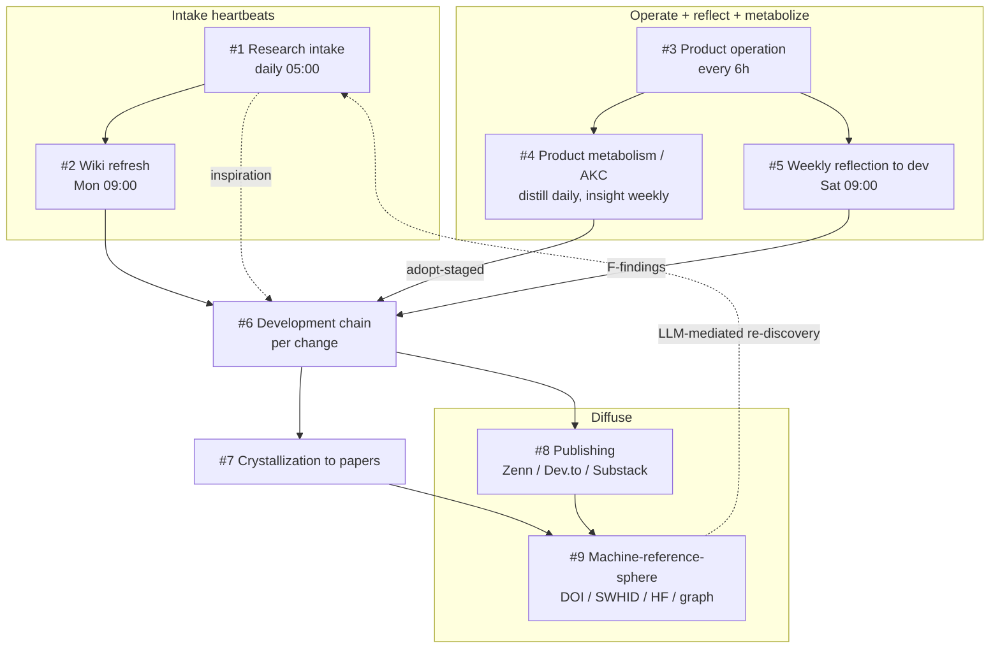

<!--
FRESHNESS
  generated: 2026-10-24
  source-commit: 68f76c0 (main when the tables were re-verified; a commit cannot name its own hash, so this is the parent — `git log 68f76c0..HEAD -- config/launchd src/contemplative_agent/cli/schedule.py scripts/weekly-pipeline.sh` lists what changed since)
  method: hand-authored from graph.jsonld (concept layer) + launchd plists (`config/launchd/`) + `cli/schedule.py` defaults + weekly/daily driver scripts + harness role contracts + sibling-repo DOIs; north-star section is a pointer only (canonical: ADR-0080; operative summary: CLAUDE.md § 北極星, moved 2026-08-26)
  columns-added: 2026-10-24 — Approver / Record / Public? master-table columns and the GOVERNANCE.md pointer (P1-12.7); the rows themselves were not re-verified
  refresh: re-verify the master table rows, the scheduled-jobs table and the operating model against live assets (see "Sources & verification" at the bottom) after any change to schedules, pipelines, orchestration contracts, or the research-program repo set
-->

# Driving Cycles — Contemplative Agent Research Program

This document maps **how the project is driven forward**, not what the code looks like.
File-level structure is derived from code on demand (LSP / `grimp`, [ADR-0102](adr/0102-retire-codemaps.md)); for the concept-level
relationship graph see [../graph.jsonld](../graph.jsonld); for design decisions see [adr/](adr/README.md).

The program is **not a single repository**. It is a spiral of **nine interlocking cycles** that
span several repos and external channels. The backbone is:

> **operate → reflect + metabolize → develop → crystallize → diffuse**, with **research intake**
> feeding the top of the spiral.

A key property: **the automated legs run on their own (heartbeats), and the human gate sits almost
entirely on the *promotion edges*** — the step where a note, report, or candidate becomes a durable,
citable artifact (an ADR, a code change, a deposit, a publication). Machines produce the raw material
on a cadence; a human decides what is promoted.

The "shared workspace" is **the repositories themselves** — their domain docs plus the rules /
CLAUDE.md that route each working session to the right context. A terminal multiplexer (e.g. herdr)
only decides *where panes run*; the shared context lives in the repos.

---

## Operating model — persistent contracts, replaceable workers

Two different agent layers must not be conflated:

- The **runtime agent** is the Contemplative Agent product: it operates in Cycle #3, metabolizes
  experience into knowledge and value-layer candidates in Cycle #4, and becomes the subject of
  observation and diagnosis in Cycle #5.
- The **program workers** are the Claude Code / Codex sessions and scheduled scripts that operate
  the research program. A worker is replaceable: it may start with a fresh context, run one bounded
  role, write or review an artifact, and exit.

Program-level continuity therefore belongs to contracts and artifacts, not to a named worker's
private persona or conversation memory:

| Persistent concern | Canonical home | Operating consequence |
|---|---|---|
| Role identity | `CLAUDE.md`, rules, skills, and agent definitions | A different session or engine can perform the same role without redefining it |
| Compounding memory | reports, ADRs, task ledgers, and audit records | Later workers inherit durable artifacts rather than another worker's private recollection |
| Coordination | explicit input/output artifacts between cycles | The handoff survives the session that produced it |
| Review independence | author/reviewer separation in the development, writing, and paper chains | Review runs in a separate context; high-stakes paths add cross-model review where specified |
| Authority | the human promotion edges below | Workers propose, diagnose, implement, and review; a human promotes durable changes |

Cycle #5 is the clearest example. The unattended Saturday chain (`scripts/weekly-pipeline.sh`,
ADR-0085 / ADR-0098) runs **one** headless session (`/weekly-report`): the observation-only
instrument document (six sections, deviation-driven, RFC-0010 — the operator reads decisions
through the gate's per-item explanations rather than the document itself), then diagnosis
producing F1/F2/F3 findings from its Deviations + Exceptions, then draft filing into the task
ledger — no repairs, no patches. Repairs travel through the task-triage loop (premise
verification → owner digest → worktree dispatch → human merge), and the value-layer decisions
happen in the Saturday `/weekly-gate` session over the findings and the per-week instrument
JSONs. Diagnostician, triage judge, implementer, and promoter remain distinct responsibilities;
the independence that used to live on session boundaries now lives on the ledger boundary
(findings are advisory; triage re-verifies premises before anything is built).

This model deliberately keeps execution identity lightweight. A session's useful result compounds
only after it lands in the appropriate shared artifact; the session itself is not an additional
source of truth.

---

## North star (pointer)

Canonical: [ADR-0080](adr/0080-north-star-layered-end-state.md) (amended 2026-08-26 —
autonomous metabolism and metabolic quality; amended 2026-10-24 — no optimization target, the
north star is not getting stuck). Operative summary: `CLAUDE.md` § 北極星
(loaded every session; synced in the same PR as any ADR-0080 amendment).

---

## Master table

| # | Cycle | Cadence / trigger | Agent / automated leg | Human gate (promotion edge) | Main artifacts | Home | Approver | Record | Public? | Driver |
|---|---|---|---|---|---|---|---|---|---|---|
| 1 | **Research intake** | daily 05:00 — `com.shimomoto.daily-research` | source discovery → Vault notes + graph | surfaced candidate (e.g. via `wiki-harvest`) → ADR / graph / code | `daily-research/` notes, `wiki/concept/` | sibling repo `daily-research/` | Accountable operator, at promotion | Vault notes (private) | No | owner-private |
| 2 | **Wiki refresh** | weekly Mon 09:00 — `com.shimo.wiki-refresh` | wiki maintenance / re-synthesis | — | Obsidian Vault `wiki/` | Vault | — | Vault `wiki/` | No | owner-private |
| 3 | **Product operation** | every 6h, 00/06/12/18 JST — `com.moltbook.agent` | live sessions → episode logs / comment-reports | — | `logs/`, `reports/comment-reports/` | CA runtime (`MOLTBOOK_HOME`) | — (no promotion) | `logs/` (`episodes/`, `api-audit.jsonl`), comment-reports | Reports yes; `logs/` never | public |
| 4 | **Product metabolism (AKC)** | distill daily; insight weekly (staged) — `com.moltbook.distill` / `com.moltbook.insight`; identity monthly (staged by cycle 5's chain, ADR-0091); constitution amendment on due-reading, human-initiated (ADR-0090/0091; shadow readings as third gate material, ADR-0092) | Extract (distill) / Curate (insight) | `adopt-staged` (approval gate, ADR-0012) | `knowledge.json`, identity / skills / rules / constitution | CA + data repo | Accountable operator, signed (ADR-0116) | `audit.jsonl` row, `.rejected/`, snapshot | Value layer yes; `.rejected/`, `.archive/`, `.staged/` no | public |
| 5 | **Weekly reflection → dev** | weekly Sat 09:00 — `com.moltbook.weekly-pipeline` (+ `com.moltbook.watchdog`, ADR-0085 / ADR-0098) | unattended chain: materials → one `/weekly-report` session (instrument document + diagnosis + draft filing, RFC-0010) → value-layer due check (+ monthly identity staging, ADR-0091) → dead-code scan → docs-consistency scan (ADR-0093) → never-selected reading (the materials also carry the relevance face reading: margin, Ollama version, the window around an identity adopt — ADR-0113 amendment 6) | `/weekly-gate` Saturday session (`adopt-staged`, dead code, retirement) + task-triage loop for the filed candidates | `reports/analysis/weekly-*.md`, `-findings.md`, per-week instrument JSONs, `PIPELINE-STATUS.md` | CA | Accountable operator, at `/weekly-gate` | `pipeline-metrics.jsonl` (`gate_item`, `gate_record`), `audit.jsonl` | Reports yes; metrics logs no | public |
| 6 | **Development chain** | per change, on demand | planner → TDD → parallel reviewers (incl. codex-review) → doc-sync → verify | pre-commit diff approval | code, tests, ADR; face ledger re-derived by `config/prompts/*.md` × callers, its temperature / failure-direction / truth-judge columns in [docs/evidence/rfc-0047/face-ledger-columns.md](evidence/rfc-0047/face-ledger-columns.md) | CA | Accountable operator (diff approval); judge may merge outside the protected classes, never push (D-P1-13-1 = C, see [GOVERNANCE.md](GOVERNANCE.md)) | git commit with trailers | Yes | public |
| 7 | **Crystallization → papers** | on demand | essays → position-paper drafting → independent parallel review → citation gate | deposit (human) | position papers (DOI-registered) — index in [hub](https://github.com/shimo4228/shimo4228#papers) | AKC / AAP repos | Accountable operator, at deposit | DOI record | Yes | public |
| 8 | **Diffusion (publishing)** | on demand | collect-context → article-writing → editor / reviewer / fact-check → ja-to-en → substack | publish (human) | Zenn (ja) / Dev.to (en) / Substack essays | `zenn-content/` | Accountable operator, at publish | the published piece | Yes | owner-private |
| 9 | **Machine-reference-sphere optimization** | periodic / on demand | citation-sync / release-doi (procedure: [docs/runbooks/release.md](runbooks/release.md)) / hf-sync / `contemplative-agent sync-data` (a CLI, not an `install-schedule` job — see the scheduled-jobs table) | deposit / DOI minting approval | DOI, SWHID, HF mirrors, graph citation edges | all repos | Accountable operator, at deposit / DOI | DOI, SWHID, HF mirrors | Yes | public (`sync-data`, CLI) + owner-private (skills) |

**Cycle 6 sub-loop — the face-improvement loop** (promoted from [RFC-0047](../rfcs/0047-face-eval-loop.md), D-P1-02-2 = B; the frozen ledger snapshot, tier table and birth-certificate template are in [docs/evidence/rfc-0047/](evidence/rfc-0047/README.md)). One judgment call = one *face* (prompt file, `DECISION_FACES` entry, threshold, record series and weekly reading share that grain). A face moves through Observation (a production reading shows a defect) → Measurement (a frozen, labelled set scored offline; the lab metric is kept only after it is shown to correlate row-by-row with the production reading, otherwise it is dropped) → Implementation (behind a seam and an env kill switch: *tier L*, where the error direction is shrinking and reversible, is enforce-first with the old path run in parallel and both recorded; *tier H* is shadow-first) → Validation (the clock is rows, not weekdays: n is derived from a pre-registered question, and when it is reached a ten-minute face gate says enforce / kill / retire, any weekday; a face that cannot fill n in 14 days is decided, not extended) → Ratcheting (deterministic checks block in `verify.sh`; the LLM eval is a merge condition for PRs that touch the face's prompt or code, never a commit gate) → Continuation (next face). Labels are bought once and scored many times, pinned by identity / prompt / model sha. Comment outcomes are never the dependent variable. Every face needs a birth certificate in its owning ADR's `Review-when > Consumption plan` (ADR-0101), and the loop itself dissolves when every face is either "no divergence" or "unmeasured, not started". It adds no machinery and does not change the Saturday gate, which stays value-layer only.

**Scheduled jobs.** The `com.moltbook.*` set below is exactly the set of `config/launchd/` templates
(`tests/test_cycles_doc.py` compares the two). Cadences are the `install-schedule` defaults in
`src/contemplative_agent/cli/schedule.py`; the day and hour of the weekly jobs are flags there.

| Label | Cadence (default) | Installed by | Cycle |
|---|---|---|---|
| `com.moltbook.agent` | every 6 h at 00:00 / 06:00 / 12:00 / 18:00, 60-minute sessions | `install-schedule` | #3 |
| `com.moltbook.distill` | daily 03:30 | `install-schedule` (`--no-distill` skips) | #4 |
| `com.moltbook.insight` | Sat 08:00 | `--weekly-insight` | #4 |
| `com.moltbook.weekly-pipeline` | Sat 09:00 | `--weekly-pipeline` | #5 |
| `com.moltbook.watchdog` | daily 04:30, Sat 12:30 / 13:30, Mon 11:00 | `--watchdog` | #5 |
| `com.moltbook.submolt-scan` | Thu 03:00 | `--weekly-submolt-scan` | #3 (read-only instrument, ADR-0086) |
| `com.moltbook.backup` | Mon 10:00 | `--weekly-backup` | runtime backup (private mirror) |
| `com.moltbook.ollama-restart` | daily 23:55 | by hand via `launchctl` (reference template only) | #3 (daemon upkeep) |

`contemplative-agent sync-data` (Cycle #9) has no template in `config/launchd/`. It runs daily at 05:30
from a hand-installed launchd job (`com.moltbook.sync-data`) that `install-schedule` does not manage
(ADR-0010 note of 2026-10-15); it can also be run by hand at any time. The same sentence stands in
`README.md` ("What it will not do") and in ADR-0010's note.

---

## The spiral (how the cycles connect)

Read the dotted edges as the two loops that close the spiral: intake **inspires** new development,
and diffusion into the machine-reference sphere makes the work **re-discoverable** by the next
research-intake pass (LLM-mediated).

---

## Human gates = the promotion edges

Automated and on-demand agent legs produce and review the candidate artifacts; a human owns each of
these promotions:

- **#1** research candidate (including a `wiki-harvest` ledger candidate) → `docs/adr/`,
  `graph.jsonld`, `glossary.md`, or code
- **#4** staged insight → identity / skills / rules / constitution (`adopt-staged`, ADR-0012)
- **#5** weekly F1/F2/F3 findings → ADR / task ledger (`rfcs/`) / code change
- **#6** implemented diff → commit (after the Verify gate)

For Cycle #5, edge #4 is exercised in the Saturday `/weekly-gate` session over the findings
and instrument JSONs (ADR-0098 retired the decision packet), while edges #5–#6 travel through
the task-triage loop: the diagnosis files candidates, the owner adopts them at the triage
digest, and implemented diffs merge on the human's word. Every promotion stays human.

- **#7** drafted paper → Zenodo / SSRN deposit
- **#8** reviewed article → Zenn / Dev.to / Substack publish
- **#9** release → DOI minting; new external citations → `.zenodo.json` + graph edges

This is why adding driver-level automation rarely means "add a scheduler": the schedulers already
exist. The leverage is on how promotion decisions are surfaced, reviewed, and recorded.

---

## Shared substrate (the actual "shared room")

The cycles cohere because they read and write a common, layered context:

- **`graph.jsonld`** (concept layer) — the Research Program Hub federates the research lines and
  encodes the AKC Phase 1–6 → Contemplative Agent mapping, the 4 axioms, the 3 memory layers, the
  ADR catalog, Concepts, and ExternalReference citation edges.
- **code + LSP** (file layer, derived — nothing stored) + **`docs/adr/`** (decision layer) + **CLAUDE.md / rules** (routing layer).

Any working session — in whatever pane it runs — picks up its domain's context from these files.
The session's private context is disposable and never authoritative: a conclusion that must survive
is written to the artifact layer appropriate to its role. That routing and artifact layer, not a
third-party workspace product, is what makes separate sessions a team.

---

## Papers & DOIs (pointer — not duplicated here)

The canonical index of the program's position papers, and every research line's concept DOI, lives
in the **hub repo**, which exists precisely to keep those citation pointers in one place. Copying
titles/DOIs into this file would go stale, so this doc only points:

- Papers → [shimo4228 research hub — **Papers**](https://github.com/shimo4228/shimo4228#papers)
- Per-line concept DOIs → the hub's ecosystem table ([shimo4228/shimo4228](https://github.com/shimo4228/shimo4228#readme))

Cycle #7 deposits into that index; Cycle #9 keeps the pointers in sync.

---

## Intake → development landing modes

The two intake paths close their loops with different degrees of procedural specificity:

- **Cycle #5 (weekly reflection → dev) has a fixed chain**: materials collection → one
  unattended `/weekly-report` session (instrument document + diagnosis + draft filing) → task-triage loop
  for repairs, `/weekly-gate` for value-layer promotion (ADR-0085 / ADR-0098), with a visible trail in ADRs
  (e.g. ADR-0040 created the diagnosis skill; several later ADRs cite a specific weekly report as
  their trigger — grep `docs/adr/` for `weekly` to regenerate the current list rather than
  freezing it here).
- **Cycle #1 (research intake → dev) is intentionally method-flexible**. `wiki-harvest` already
  provides one structured route from the read-only research wiki to a repo-local candidate ledger,
  but it is not the required or exclusive route. Direct consultation of the wiki, primary-source
  reading, or another research workflow may surface the same kind of candidate. The invariant is
  the landing discipline: trace the claim to a primary source, name a concrete repo destination,
  and leave promotion into ADR / graph / code to the human gate.

The fixed part is the evidence and promotion contract, not the tool used to surface a candidate.

---

## Sources & verification

Each master-table row corresponds to a live asset. To re-verify after changes:

- Schedules: `config/launchd/*.plist` (the scheduled-jobs table is checked against it by `tests/test_cycles_doc.py`) and the defaults in `src/contemplative_agent/cli/schedule.py`; on the owner's machine `ls ~/Library/LaunchAgents/com.moltbook.*` shows what is actually loaded (Cycles #1 / #2 are owner-private and are not verified from this repo)
- Cycle #5 driver: `scripts/weekly-pipeline.sh` (wraps `scripts/weekly-analysis.sh` as its
  materials collector), `scripts/pipeline_watchdog.sh`,
  `scripts/docs_consistency_scan.py` (ADR-0093),
  `config/prompts/weekly-analysis.md` / `weekly-analysis-ja.md` / `principles.md`,
  `.claude/skills/weekly-report/SKILL.md`, `.claude/skills/weekly-gate/SKILL.md`;
  outputs in `~/.config/moltbook/reports/analysis/` (+ `PIPELINE-STATUS.md`,
  `logs/pipeline-metrics.jsonl`)
- Roles, artifact classes × approvers, and where each record lives: [GOVERNANCE.md](GOVERNANCE.md).
  Program-worker role and review contracts: `~/.claude/rules/common/agents.md`,
  `~/.claude/rules/common/planning.md`, and the `writing-ecosystem` / `paper-ecosystem` skills
- Cycle #1 driver: `daily-research/scripts/daily-research.sh`; consumers
  `~/.claude/skills/wiki-harvest/`, `~/.claude/skills/wiki-query/`
- Papers / DOIs (canonical index): [hub `## Papers`](https://github.com/shimo4228/shimo4228#papers); per-repo `CITATION.cff` + `.zenodo.json`
- Concept layer: [`../graph.jsonld`](../graph.jsonld)
- Cycle #3/#4 mechanism map (episode → patterns → skills / identity / constitution → prompt): [`diagrams/`](diagrams/README.md) — Archify JSON is canonical, HTML is the rendered output
